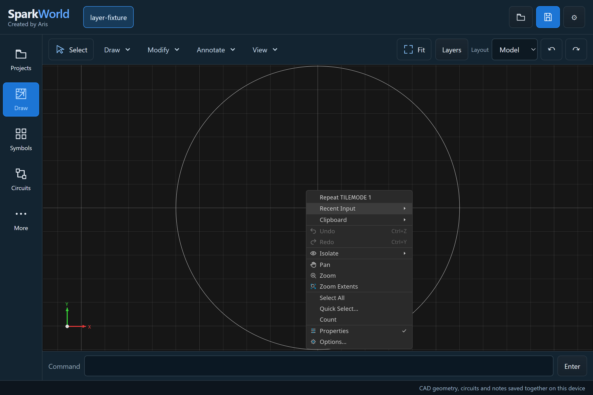
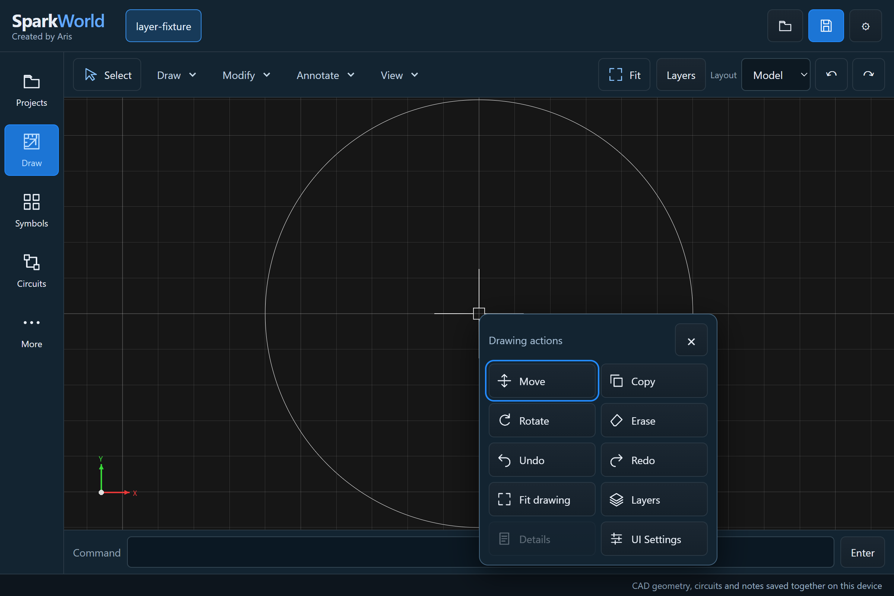
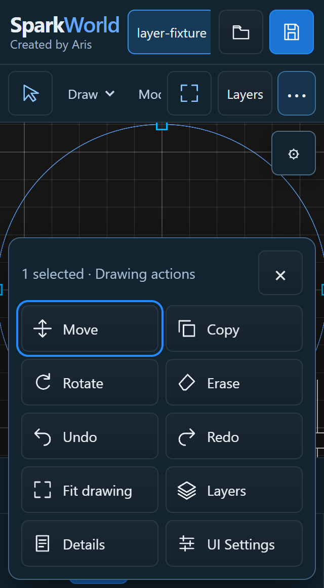

# SparkWorld drawing actions

Actual headless Chromium captures, using the authored layer fixture at 1200 × 800 logical pixels and DPR 2. The before capture replays the exact workspace JavaScript from `c423f020cebb09391bde613d147437c71385131c` from RAM; both captures use the same final CAD engine, fixture, viewport and Studio profile. These are runtime images, not concepts or private drawings.

Before: the engine's context menu remained visible inside the workspace.

After: drawing actions use SparkWorld controls and native document operations. Active commands expose Accept and Cancel. Details requires a selection; Layers and UI Settings open the existing owned panels. Typed `LAYER`, `PROPERTIES` and `OPTIONS` use the same panels.

The menu also stays inside a narrow 320 × 580 viewport.

Regression: `tests/cad-context.cjs`, including native Undo/Redo, Move selection, cancellation, explicit properties, command routing and viewport bounds. This is browser emulation; it does not establish physical iPhone performance.
