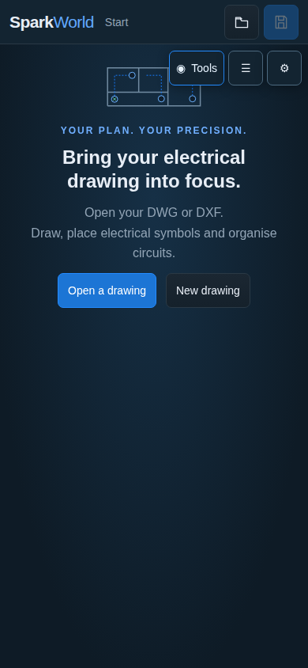
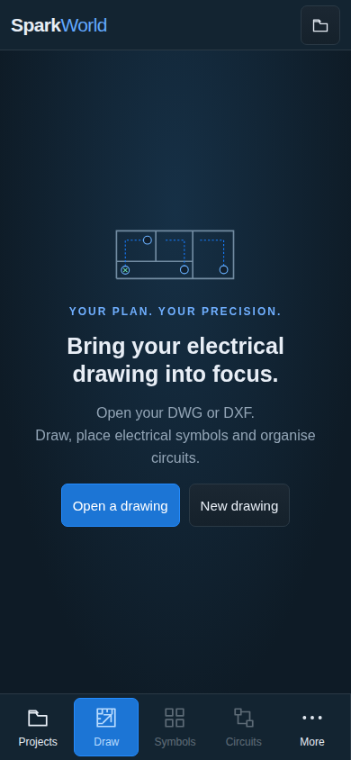

# SparkWorld · Mobile start screen

Actual browser captures at **390 × 844**, with a fresh browser profile and no drawing open. These are runtime screenshots, not concept images.

## Before

Floating controls covered the welcome illustration and the default navigation was hidden. The regression check failed on source `4cc84cb`, whose product UI matched public `172e8ad`.

## After

The start screen has its own layout. Five main actions stay in the bottom navigation by default; drawing tools appear when a drawing is open. The welcome artwork, heading and Open/New actions remain clear. Explicitly saved focus preferences remain available.

Verified on source `53853ea`: 76 UI checks passed, including 320/390/430-pixel widths and the saved focus profile. The public fix is commit `1bd5752`; its deployment is tracked in [GitHub Actions](https://github.com/ArisConstantinou/spark/actions/runs/41640919370).

These captures use headless Chromium. Physical iPhone/Safari behavior still needs a device check.
