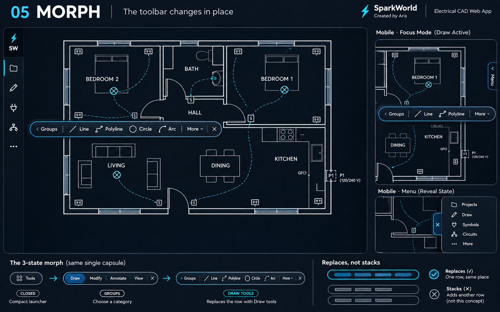
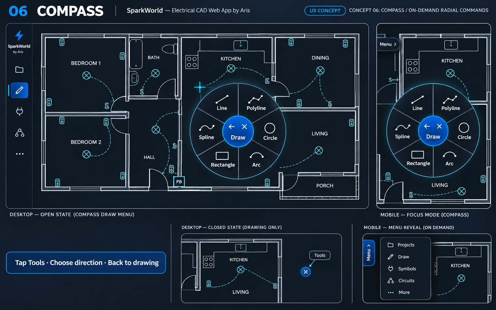
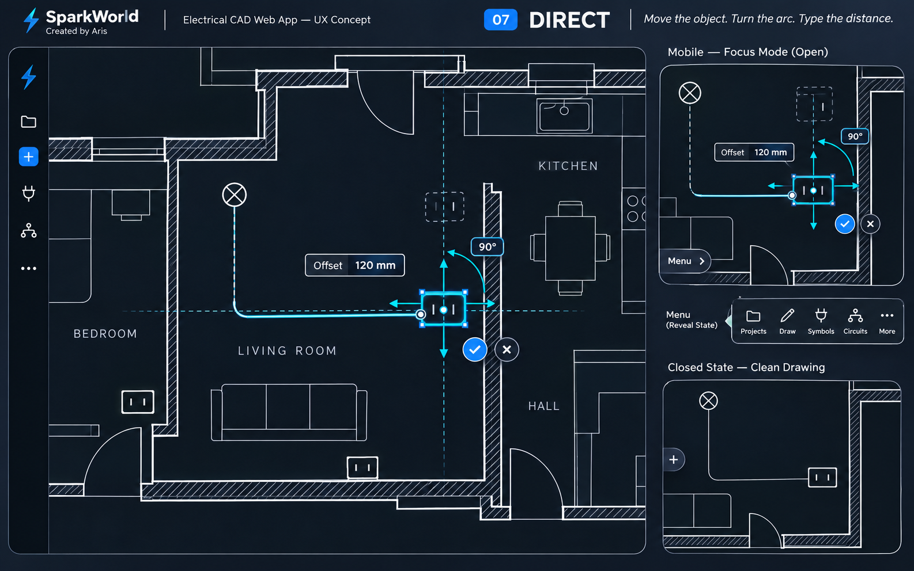
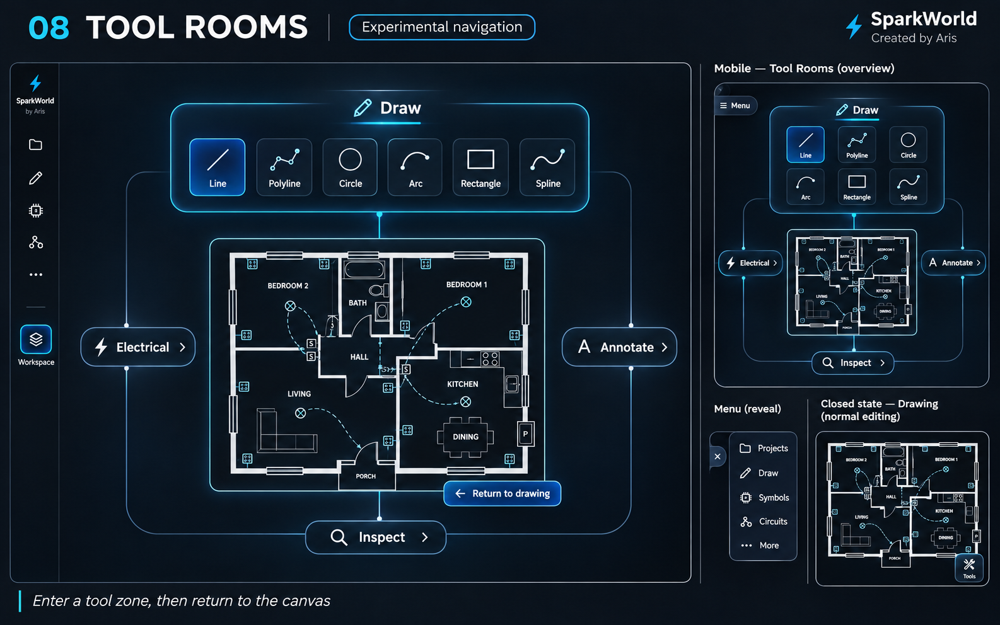

# SparkWorld · Canvas first · Concepts 5–8

Νέα σειρά: **χωρίς stacking και χωρίς μόνιμες πάνω/κάτω εργαλειοθήκες**.
Οι εικόνες δείχνουν ανοιχτή/κλειστή κατάσταση και mobile Focus Mode. Είναι AI concept images, όχι υλοποιημένες λειτουργίες ή πραγματική ηλεκτρολογική μελέτη.

## 5 · Morph

Μία μικρή λωρίδα αλλάζει περιεχόμενο: **Tools → Draw → Line**. Η ίδια θέση, χωρίς να προστίθεται άλλη σειρά.

## 6 · Compass

Ένα προσωρινό κυκλικό μενού ανοίγει κοντά στο σημείο εργασίας. Διαλέγεις εργαλείο και επιστρέφεις στο σχέδιο.

## 7 · Direct

Μετακίνηση, περιστροφή και ακριβείς τιμές πάνω στο επιλεγμένο αντικείμενο, μέσω χειριστηρίων αντί για μεγάλη μπάρα εντολών.

## 8 · Tool Rooms

Πειραματική χωρική επισκόπηση: ανοίγεις μια περιοχή εργαλείων, επιλέγεις και επιστρέφεις στον καμβά.

Πάτησε μια εικόνα για μεγέθυνση. Επίλεξε **5–8**, ή συνδυασμό.

Πηγές έρευνας: [Fusion marking menus](https://help.autodesk.com/cloudhelp/ENU/Fusion-GetStarted/files/GUID-6514ABC1-CB75-4F0B-AB0E-316FAD36BA93.htm), [Onshape manipulators](https://cad.onshape.com/help/Content/Home/triad_manipulator.htm), [tldraw handles](https://tldraw.dev/sdk-features/handles), [Blender areas](https://docs.blender.org/manual/en/5.3/interface/window_system/areas.html), [Figma tools](https://help.figma.com/hc/en-us/articles/360041064174-Access-design-tools-from-the-toolbar), [Miro toolbars](https://help.miro.com/hc/en-us/articles/360017730553-Toolbars).
